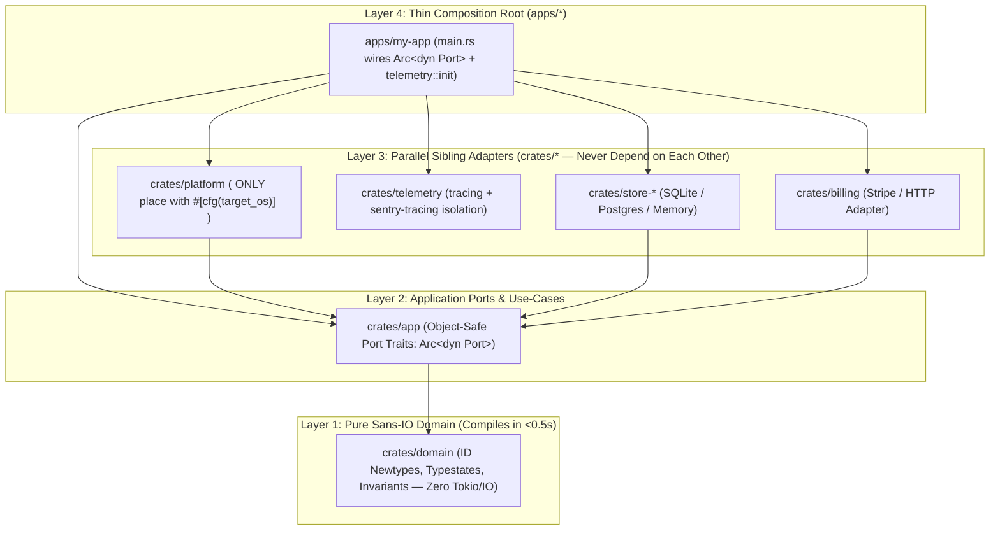
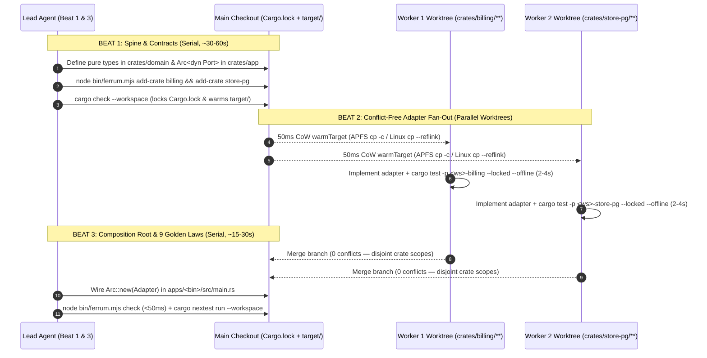

# FERRUM — Fast Multiplatform Rust Agent Protocol

> **F**lat-DAG · **E**dge-Isolated · **R**eflink-Warmed · **R**atchet-Guarded · **U**nified-Deps · **M**ulti-Agent
>
> **The Golden Protocol & Executable Skill Suite for building, rescuing, and scaling 100k–1M+ LOC multiplatform Rust applications (Windows, macOS, Linux) with sub-10s TDD loops and conflict-free multi-agent orchestration across Google Antigravity, Claude Code, and OpenAI Codex.**

---

## Why FERRUM Exists

Large-scale Rust development with AI coding agents hits **four predictable walls**:

1. **Compile & Link Latency:** Deep dependency chains (`a → b → c → d → e → f`) starve CPU cores, full DWARF/PDB debuginfo bloats link times, 20 separate `tests/*.rs` files link 20 separate binaries, and macOS XProtect (`syspolicyd`) or Windows Defender scans every newly linked test binary before it can execute.
2. **Architectural & Lifetime Rigidity:** Lifetimes (`'a`) on domain structs, `Arc<Mutex<_>>` sprawl, and scattered `#[cfg(target_os = ...)]` turn small changes into workspace-wide refactors.
3. **Multi-Agent Worktree Collisions:** When parallel AI workers (`codex_batch` or parallel git worktrees) edit root `Cargo.toml` or `Cargo.lock` simultaneously, they trigger merge conflicts and invalidate Cargo's workspace-wide feature hash—or wait 3 minutes per worktree for a cold `target/` rebuild.
4. **Silent AI Runtime & Security Bugs:** Under task pressure, LLMs frequently call `std::thread::sleep` / `std::fs` inside `async fn` (starving Tokio workers), use `unbounded_channel` (causing production OOMs under load), or put `#[derive(Debug)]` on structs holding `api_key` / `password` (leaking credentials into logs and Sentry).

**FERRUM** solves all four walls by combining **architecture rules, compiler/linker tuning, 50ms Copy-on-Write worktree seeding, a `<50ms` 9-Law static guardrail, a Brownfield Strangler-Fig Ratchet, and a 3-Beat Multi-Agent Wave Protocol** into one zero-dependency toolkit.

---

## The FERRUM Mnemonic

| Letter | Pillar | What It Enforces |
| :--- | :--- | :--- |
| **F** | **Flat-DAG** | Internal workspace dependency depth $\le 4$ (`domain → app → sibling adapters → thin bin`) so Cargo compiles all adapters across all CPU cores in parallel. |
| **E** | **Edge-Isolated** | OS conditional compilation (`#[cfg(target_os)]`) lives **only** in `crates/platform`; Sentry/OpenTelemetry lives **only** in `crates/telemetry`; `crates/domain` is 100% pure (Sans-IO). |
| **R** | **Reflink-Warmed** | Parallel git worktrees start from a **50ms Copy-on-Write (`cp -c` APFS / `cp --reflink` Btrfs/XFS)** clone of `target/debug/{deps,build,.fingerprint}`, skipping `rust-analyzer`, `release`, and `.cargo-lock`. |
| **R** | **Ratchet-Guarded** | `<50ms` static guardrail (`ferrum check`) enforces **The 9 Golden Laws**. On brownfield repos, `--write-baseline` freezes legacy debt in `.codex-team/arch-baseline.json` so **only new violations fail**. |
| **U** | **Unified-Deps** | All shared dependencies and features live in root `[workspace.dependencies]` (`resolver = "3"`) with zero per-crate feature overrides—eliminating cache thrashing between `cargo test -p` and `--workspace`. |
| **M** | **Multi-Agent 3-Beat** | Parallel agent waves execute in **3 Beats** (Beat 1 Serial Spine & `ferrum add-crate` → Beat 2 Disjoint Adapter Fan-Out → Beat 3 Composition Root), guaranteeing **zero `Cargo.toml`/`Cargo.lock` merge conflicts**. |

---

## 1-Command Installation (Antigravity, Claude Code & Codex CLI)

```bash
git clone https://github.com/lmsutools/ferrum-fast-multiplatform-rust-agent-protocol.git
cd ferrum-fast-multiplatform-rust-agent-protocol
npm run setup
```

`npm run setup` (`node scripts/setup-all.mjs`) automatically links the FERRUM skill across all three agent ecosystems on macOS, Linux, and Windows (using junctions on Windows—no Admin privileges required):
- **Claude Code:** `~/.claude/skills/weedo-rust-dev-skill`
- **OpenAI Codex CLI:** `~/.codex/skills/weedo-rust-dev-skill`
- **Google Antigravity:** `~/.gemini/config/skills/weedo-rust-dev-skill` + toggleable plugin `~/.gemini/config/plugins/ferrum-rust-suite`

---

## Architecture: The 4-Layer Wide Crate Graph & 3-Beat Wave Protocol



### The 3-Beat "Contract-First Fan-Out" Protocol for Parallel Agents

Never allow parallel AI workers to edit root `Cargo.toml`, `Cargo.lock`, `crates/domain`, or `crates/app` at the same time:



---

## The 9 Golden Laws (`node bin/ferrum.mjs check`)

`scripts/check-rust-arch.mjs` audits any Rust workspace in **<50ms** without invoking `rustc`. Its output uses standard `error[arch::*]: ... --> file:line:column` syntax so `rustDiagnostics` and IDE problem matchers parse it natively:

| # | Rule ID | Category | What It Enforces & Why |
| :--- | :--- | :--- | :--- |
| **1** | `arch::no_workspace_feature_thrash` | Build Cache | Forbids `dep = { workspace = true, features = [...] }` in member crates (except `crates/telemetry`). Ensures `cargo test -p <crate>` and `cargo test --workspace` share one artifact cache hash. |
| **2** | `arch::single_integration_test_binary` | Link Speed | Forbids multiple `tests/*.rs` files per crate; requires a single `tests/it/main.rs` entry point (measured **3.4× faster rebuild** and **~10× faster test startup** on macOS). |
| **3** | `arch::platform_cfg_isolation` | Portability | Forbids `#[cfg(target_os / target_family / unix / windows)]` outside `crates/platform`. Keeps 95%+ of the codebase 100% OS-agnostic. |
| **4** | `arch::pure_domain` & `arch::sibling_adapter_isolation` | Parallelism | Forbids IO/runtime crates (`tokio`, `reqwest`, `sqlx`, `axum`, `sentry`) in `crates/domain` and forbids adapter-to-adapter dependencies. |
| **5** | `arch::workspace_lints` | Hygiene | Requires `[lints] workspace = true` in every member crate (`await_holding_lock = "deny"`, `unsafe_op_in_unsafe_fn = "deny"`). |
| **6** | `arch::max_workspace_depth` | CPU Utilization | Enforces internal workspace dependency chain depth $\le 4$ so Cargo compiles all adapters concurrently. |
| **7** | `arch::no_blocking_in_async` | Runtime Safety | Forbids `std::thread::sleep`, `std::fs::*`, and `reqwest::blocking` inside modules containing `async fn` (outside `#[cfg(test)]`). Prevents Tokio executor starvation. |
| **8** | `arch::no_unbounded_channels` | Memory Safety | Forbids `unbounded_channel(` in production `src/` code. Forces bounded channels so backpressure never becomes a production OOM. |
| **9** | `arch::no_unredacted_secrets` | Security | Forbids raw `String` / `&str` fields named `password`, `secret`, `api_key`, `access_token`, `refresh_token`, `private_key`, or `client_secret` inside `#[derive(Debug)]` structs. |

---

## CLI Reference (`bin/ferrum.mjs`)

```bash
# 1. Check OS environment, linker, RAM throttling, and macOS XProtect / Windows Dev Drive traps
node bin/ferrum.mjs env

# 2. Scaffold a new multiplatform Rust workspace (Ship / Ready / Out tiers)
node bin/ferrum.mjs init acme ./projects --ship macos,windows --ready linux --kind desktop --arch x64,arm64

# 3. Beat 1: Add a compliant sibling adapter crate in <50ms
node bin/ferrum.mjs add-crate billing --cwd ./projects/acme

# 4. Run the <50ms 9 Golden Laws architectural & semantic guardrail
node bin/ferrum.mjs check ./projects/acme

# 5. Brownfield Rescue: Generate a 5-phase Strangler-Fig migration plan & freeze legacy debt
node bin/ferrum.mjs check ./legacy-rust-repo --plan
node bin/ferrum.mjs check ./legacy-rust-repo --write-baseline

# 6. Run Cargo commands only on affected packages + transitive workspace dependents
node bin/ferrum.mjs affected --changed-list changed.txt -- test --locked --offline

# 7. Seed a git worktree with a 50ms CoW target/ clone (skips rust-analyzer, release, .cargo-lock)
node bin/ferrum.mjs warm-target ./projects/acme ./worktrees/worker-1

# 8. Closed-loop Sentry / BugSink / GlitchTip crash triage -> Cargo crate worktree payload
node bin/ferrum.mjs sentry-triage --issue ./crash-event.json --cwd ./projects/acme

# 9. Remote Linux VM / Vast.ai burst build with 15-min dead-man's switch & pre-review auto-poweroff
node bin/ferrum.mjs vast search --min-cores 32 --min-ram 64 --max-dph 0.50
node bin/ferrum.mjs vast create <OFFER_ID> --disk 40 --idle-mins 15
node bin/ferrum.mjs remote ssh://root@ssh5.vast.ai:41892 --vast-id <INSTANCE_ID> --poweroff \
  -- nextest run --workspace --profile ci
```

---

## Key Playbooks Included in `skills/weedo-rust-dev-skill/references/`

- **[`golden-protocol.md`](skills/weedo-rust-dev-skill/references/golden-protocol.md):** The 3-Beat Contract-First Fan-Out Wave Protocol, The 9 Golden Laws, `cargo-mutants` domain mutation testing, and `cargo-shear` dead-dependency pruning.
- **[`brownfield-migration.md`](skills/weedo-rust-dev-skill/references/brownfield-migration.md):** 5-Phase Strangler-Fig + Ratchet Playbook for rescuing existing monolithic or tangled Rust codebases without stopping feature work.
- **[`build-performance.md`](skills/weedo-rust-dev-skill/references/build-performance.md):** OS speed traps (macOS `spctl developer-mode enable-terminal`, Windows ReFS Dev Drive), `lld`/`wild`/`mold` linkers, `line-tables-only`, `build-override opt-level = 3`, Nightly `-Zthreads` + Cranelift fast-lane, and **§12 Low-Memory Dev Machine (8–16 GB RAM) Survival Profile**.
- **[`platforms.md`](skills/weedo-rust-dev-skill/references/platforms.md):** `Ship` / `Ready` / `Out` support tiers, **§8 Mac → Windows/Linux cross-compilation (`cargo-xwin`, `cargo-zigbuild`)**, and **§9 Linux → Windows/macOS cross-compilation + `wine64` Windows test runner + XFS/Btrfs CoW reflinks**.
- **[`remote-vm-builds.md`](skills/weedo-rust-dev-skill/references/remote-vm-builds.md):** Sizing rented Linux VMs by `Max Useful Cores = Total Compile Work / Critical Path`, plus **§7 Zero-Waste VM Rules (`--install-watchdog 15` dead-man's switch & `--poweroff` before local LLM review)**.
- **[`architecture.md`](skills/weedo-rust-dev-skill/references/architecture.md):** 4-layer crate topology, ID newtypes, `Arc<dyn Port>`, plus **§7 Modern Patterns (Sans-IO + Deterministic Simulation Testing, Data-Oriented Design with `bumpalo`/`lasso`/`rkyv`, Typestate, and `wasmtime` Component Model plugins)**.
- **[`telemetry-and-sentry.md`](skills/weedo-rust-dev-skill/references/telemetry-and-sentry.md):** Isolating `sentry` + `sentry-tracing` in `crates/telemetry`, `split-debuginfo` symbol uploads, self-hosted BugSink/GlitchTip compatibility, and automated Sentry-to-Worktree regression triage.
- **[`fast-tdd.md`](skills/weedo-rust-dev-skill/references/fast-tdd.md), [`modern-rust.md`](skills/weedo-rust-dev-skill/references/modern-rust.md), [`tooling-and-ci.md`](skills/weedo-rust-dev-skill/references/tooling-and-ci.md).**

---

## Testing

FERRUM's test suite uses Node's built-in test runner with **zero external npm dependencies**:

```bash
npm test
```

## License

MIT
